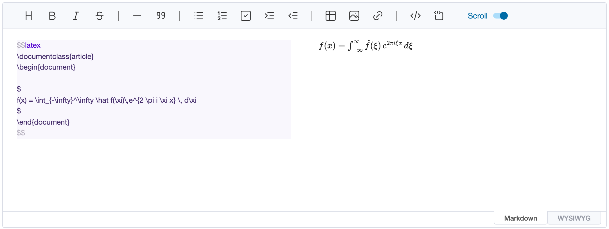
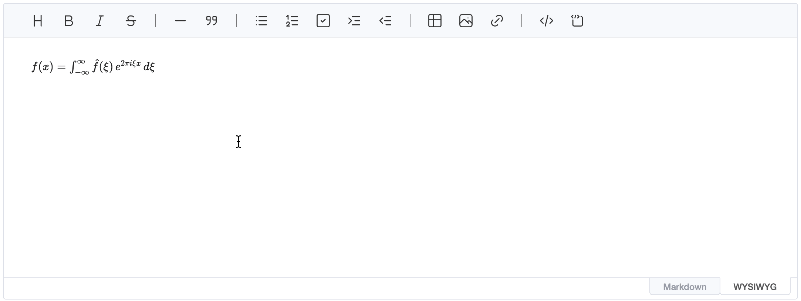
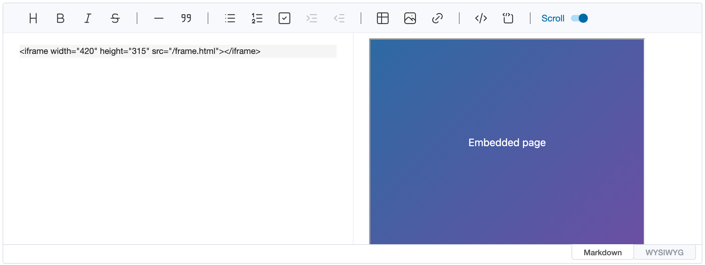
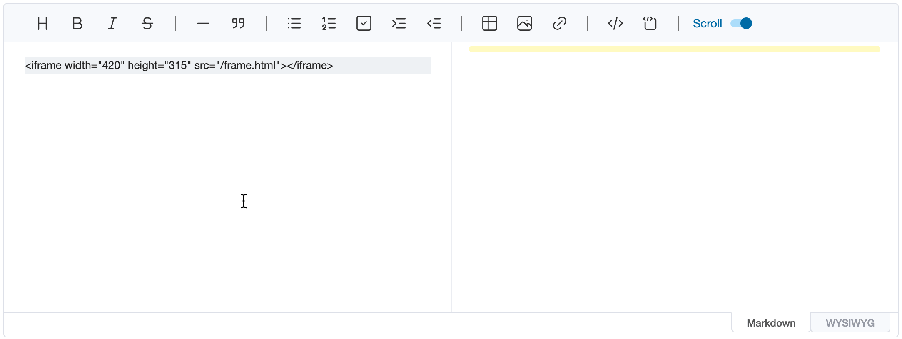
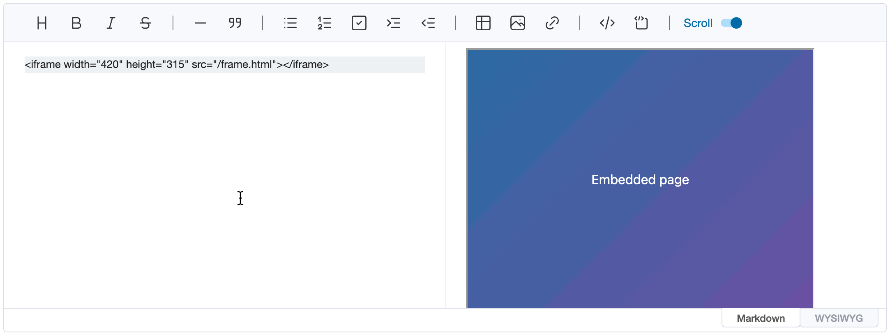

# Custom Block Node And HTML Node

The editor follows the [CommonMark](https://spec.commonmark.org/0.29/) specification, and also supports the [GFM](https://github.github.com/gfm/) specification. But what if you want to use a specific syntax that is not supported by CommonMark or GFM? For example, you might want to use [LaTeX](https://www.latex-project.org/) syntax or render elements such as charts in Markdown. The editor provides the option to define a **custom block node** for this usability.

## Custom Block Node

The editor provides the `customHTMLRenderer` option that can be customized when converting Markdown Abstract Syntax Tree(AST) to HTML text. Using `customHTMLRenderer` option, rendering results of nodes supported by CommonMark or GFM can be customized like `table` and `heading`. Custom block nodes can also be defined using this `customHTMLRenderer` option.

The following code defines a custom block node that renders LaTeX documents using [latex.js](https://latex.js.org).

```js
const editor = new Editor({
    el: document.querySelector('#editor'),
    customHTMLRenderer: {
        latex(node) {
            const generator = new latexjs.HtmlGenerator({ hyphenate: false })
            const { body } = latexjs.parse(node.literal, { generator }).htmlDocument()

            return [
                { type: 'openTag', tagName: 'div', outerNewLine: true },
                { type: 'html', content: body.innerHTML },
                { type: 'closeTag', tagName: 'div', outerNewLine: true }
            ]
        }
    }
})
```

The `latex` function property was written in the `customHTMLRenderer` option, which returns HTML to be rendered in token format. It is easy to use because it configures options in almost the same form as when customizing a markdown node. The code above is rendered in the Markdown Editor as follows.



As you can see in the image above, in order to use a custom block node in a markdown editor, text must be entered within a block enclosed by the `$$` symbol. Blocks wrapped with `$$` symbols are parsed from editor to custom block nodes. In addition, to indicate which custom block node it is, the node name defined by the `customHTMLRenderer` option must be written next to the `$$` symbol.

```markdown
<!-- The node name must be written next to the $$ symbol. -->
$$latex
\documentclass{article}
\begin{document}

$
f(x) = \int_{-\infty}^\infty \hat f(\xi)\,e^{2 \pi i \xi x} \, d\xi
$
\end{document}
$$
```

### WYSIWYG

The custom block node in the WYSIWYG Editor works like the image below.



In WYSIWYG Editor, the custom block node is rendered in the same result as a markdown preview, and can be changed by clicking on the node and using the edit button that appears when selected. Because the custom block node are eventually parsed based on specific text, editing in the WYSIWYG Editor is also based on text. This operation is different from general WYSIWYG editors, but it is more ideal because **UnderFlow's WYSIWYG editor is based on markdown**.

## HTML Node

CommonMark uses `<` and `>` characters to write nodes that are not supported by default in HTML text.
([CommonMark Raw HTML Spec](https://spec.commonmark.org/0.29/#raw-html))

Because Markdown Editor also follows these specifications, HTML text are rendered correctly in the Markdown preview. The
preview's sanitizer removes `<iframe>` and `<embed>` elements unless they have a renderer in the `customHTMLRenderer`
option, like the `iframe` renderer below, which the image uses.



### WYSIWYG

The WYSIWYG editor shows the HTML it has nodes for (such as `<b>`, `<a>` or `<table>`) as those nodes. Other HTML, such
as an `<iframe>`, a comment or attributes WYSIWYG doesn't keep, stays as its source: it's shown and edited as text and
written back to the markdown unchanged.



To show such HTML as an element in WYSIWYG instead, define it with the `customHTMLRenderer` option.

```js
const editor = new Editor({
    el: document.querySelector('#editor'),
    customHTMLRenderer: {
        htmlBlock: {
            iframe(node) {
                return [
                    { type: 'openTag', tagName: 'iframe', outerNewLine: true, attributes: node.attrs },
                    { type: 'html', content: node.childrenHTML },
                    { type: 'closeTag', tagName: 'iframe', outerNewLine: true }
                ]
            }
        }
    }
})
```

HTML nodes are defined in the `customHTMLRenderer.htmlBlock` property. To distinguish it from the custom block nodes described above, it should be configured within the `htmlBlock` property. If you run the example code, the `iframe` node is rendered as an element in WYSIWYG, as shown in the image below.



If you want to use an inline HTML node, it should be configured in the `customHTMLRenderer.htmlInline` property.

```js
const editor = new Editor({
    el: document.querySelector('#editor'),
    customHTMLRenderer: {
        htmlBlock: {
            iframe(node) {
                return [
                    { type: 'openTag', tagName: 'iframe', outerNewLine: true, attributes: node.attrs },
                    { type: 'html', content: node.childrenHTML },
                    { type: 'closeTag', tagName: 'iframe', outerNewLine: true }
                ]
            }
        },
        htmlInline: {
            big(node, { entering }) {
                return entering
                    ? { type: 'openTag', tagName: 'big', attributes: node.attrs }
                    : { type: 'closeTag', tagName: 'big' }
            }
        }
    }
})
```
