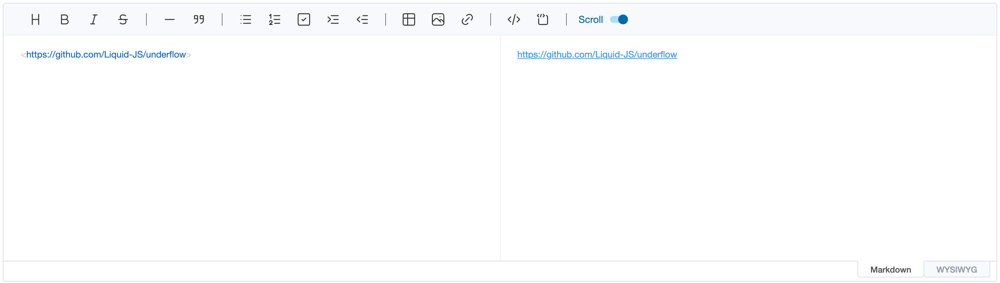
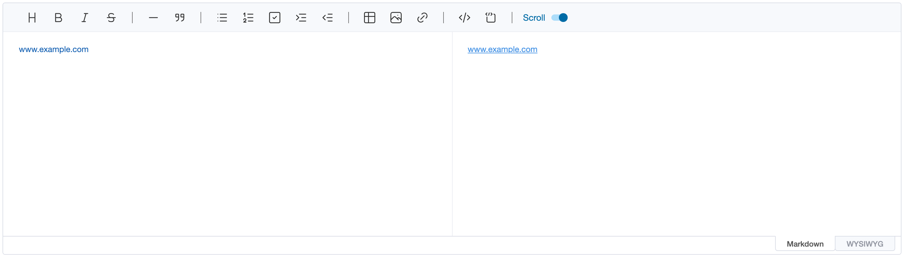
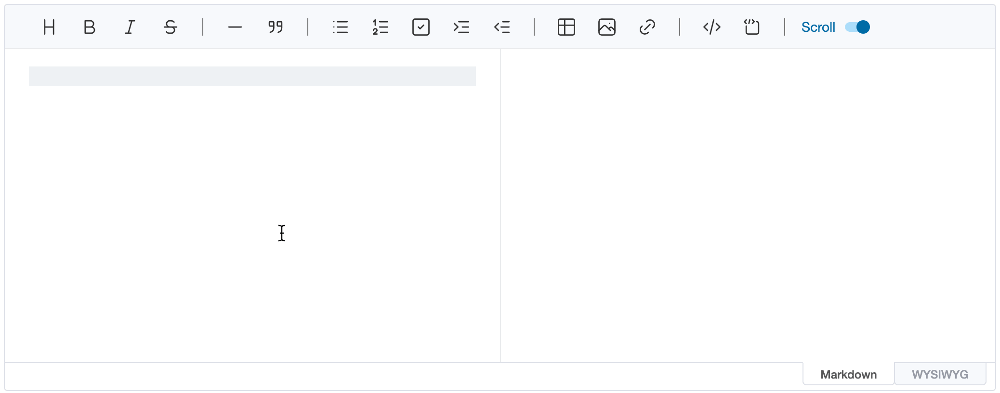

# Extending Autolinks

## What Is Autolinks?

### Autolinks

The [Autolinks](https://spec.commonmark.org/0.29/#autolinks) is the CommonMark specification like as below. (If you want to know the detail specification of the Autolinks, refer to examples in the above link.)

> Autolinks are absolute URIs and email addresses inside `<` and `>`. They are parsed as links, with the URL or email address as the link label.

The editor supports them without any configuration, because it follows the CommonMark specification.



### Extended Autolinks

The Extended Autolinks is the specification which is supported by [GFM](https://github.github.com/gfm). The specification makes the Autolinks be recognized in a greater number of conditions. For example, if the text has `www.` with a valid domain, it will be recognized as the Autolinks like as below.



More examples related with the Extended Autolinks can be found [here](https://github.github.com/gfm/#autolinks-extension-).

## Extended Autolinks Configuration

The Extended Autolinks in the editor can be used by configuring the `extendedAutolinks` option. If the `extendedAutolinks` option is not otherwise defined, the editor will automatically configure the `false` value to make the Extended Autolinks be not worked internally.

When we set the `extendedAutolinks` value to explicitly declare it `true` value, the nodes which follow the Extended Autolinks specification are parsed as link nodes in the editor.

```js
const editor = new Editor({
    // ...
    extendedAutolinks: true
})
```

## Customizing the Extended Autolinks

The editor lets you define your own Extended Autolinks by providing the callback function option. This option can be useful when you want to support the specific link format.

To customize the Extended Autolinks, `extendedAutolinks` option should be `function`. The following is a simple example snippet for configuring the option.

```js
const reUnderflowRepo = /underflow/g

const editor = new Editor({
    el: document.querySelector('#editor'),
    extendedAutolinks: (content) =>
        [...content.matchAll(reUnderflowRepo)].map((match) => ({
            text: 'UnderFlow',
            url: 'https://github.com/Liquid-JS/underflow',
            range: [match.index, match.index + match[0].length - 1]
        }))
})
```

As the code above demonstrates, the `extendedAutolinks` callback function is called with the text of each text node as `content`. If the desired link formats are found in the content, the result should be the array, and each element has `text`, `url` and `range` properties for the information of link.

-   `text`: The link label
-   `url`: The link destination
-   `range`: The first and last offset of the link in `content` (both inclusive)

With the example above, the text `underflow` is rendered as a link labelled `UnderFlow` to
`https://github.com/Liquid-JS/underflow`.


