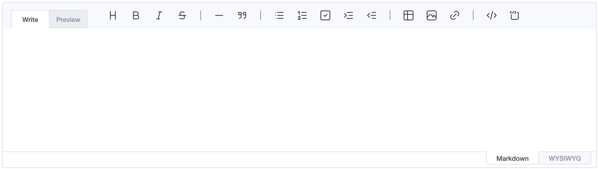
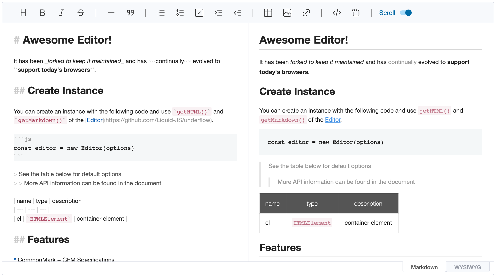

# Getting Started

## Installation

UnderFlow is published as a single ESM-only package, `@liquid-js/underflow`. ProseMirror and DOMPurify are peer
dependencies, so install them alongside it:

```sh
yarn add @liquid-js/underflow prosemirror-commands prosemirror-history prosemirror-inputrules \
  prosemirror-keymap prosemirror-model prosemirror-state prosemirror-transform prosemirror-view dompurify
```

The package provides the following entry points:

| Import                                                          | Contents                                                 |
| --------------------------------------------------------------- | -------------------------------------------------------- |
| `@liquid-js/underflow`                                          | `Editor` and `EditorCore`                                |
| `@liquid-js/underflow/viewer`                                   | `Viewer`                                                 |
| `@liquid-js/underflow/parser`                                   | The incremental markdown parser                          |
| `@liquid-js/underflow/i18n/<locale>`                            | UI translations, e.g. `i18n/de-de` (see [i18n](i18n.md)) |
| `@liquid-js/underflow/plugins/code-syntax-highlight`            | Syntax highlighting for code blocks                      |
| `@liquid-js/underflow/styles/editor.css`                        | Editor UI and contents styles                            |
| `@liquid-js/underflow/styles/editor-only.css`                   | Editor UI without the contents styles                    |
| `@liquid-js/underflow/styles/viewer.css`                        | Contents styles for the viewer                           |
| `@liquid-js/underflow/styles/theme/dark.css`                    | Dark theme, enabled with the `theme: 'dark'` option      |
| `@liquid-js/underflow/styles/plugins/code-syntax-highlight.css` | Styles for the code syntax highlight plugin              |

## Create Your First Editor

### Adding the Container Element

Add the element that the editor will be created in.

```html
...

<body>
    <div id="editor"></div>
</body>
...
```

### Importing the Editor

The editor is the package's `Editor` export.

```js
import { Editor } from '@liquid-js/underflow'
```

### Adding CSS Files

Import the editor's stylesheet. Your bundler needs to support CSS imports; otherwise, add the file from
`node_modules/@liquid-js/underflow/lib/styles/` to your page another way.

```js
import '@liquid-js/underflow/styles/editor.css'
```

If you want to style the contents yourself, import `@liquid-js/underflow/styles/editor-only.css` instead, which contains
only the editor UI. For the dark theme, also import `@liquid-js/underflow/styles/theme/dark.css` and set the
`theme: 'dark'` option.

### Creating an Instance

Create an instance with options, then call the editor's API on it.

```js
const editor = new Editor({
    el: document.querySelector('#editor')
})
```



```js
const editor = new Editor({
    el: document.querySelector('#editor'),
    height: '600px',
    initialEditType: 'markdown',
    previewStyle: 'vertical'
})
```



The basic options are:

-   `height`: Height as a string, or `auto`, e.g. `300px` \| `auto`
-   `initialEditType`: Initial editing mode, `markdown` \| `wysiwyg`
-   `initialValue`: Initial markdown content
-   `previewStyle`: Preview style of the markdown mode, `tab` \| `vertical`
-   `placeholder`: Text shown while the editor is empty, e.g. `Write something...`; `setPlaceholder()` changes it later
-   `toolbarStyle`: `wrap` lets the toolbar wrap onto several lines instead of collapsing items into the "More" button, which keeps every button reachable for keyboard and screen reader users. `default` \| `wrap`

All options are documented in the type definitions (`EditorOptions` in `@liquid-js/underflow`).

## Example

```js
import { Editor } from '@liquid-js/underflow'
import '@liquid-js/underflow/styles/editor.css'

const editor = new Editor({
    el: document.querySelector('#editor'),
    height: '500px',
    initialEditType: 'markdown',
    previewStyle: 'vertical',
    initialValue: '# Hello'
})

editor.on('change', () => console.log(editor.getMarkdown()))
```
