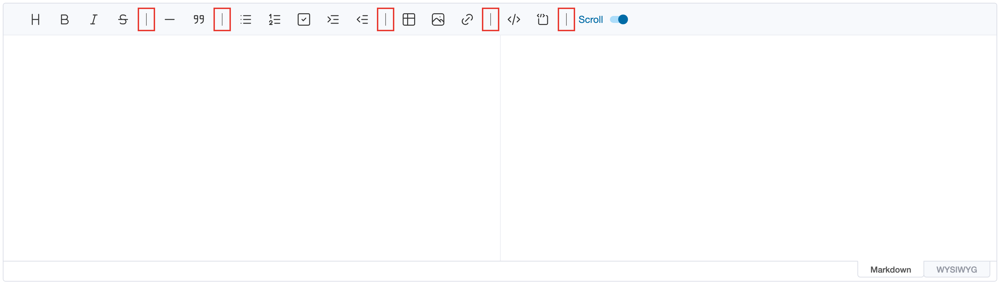
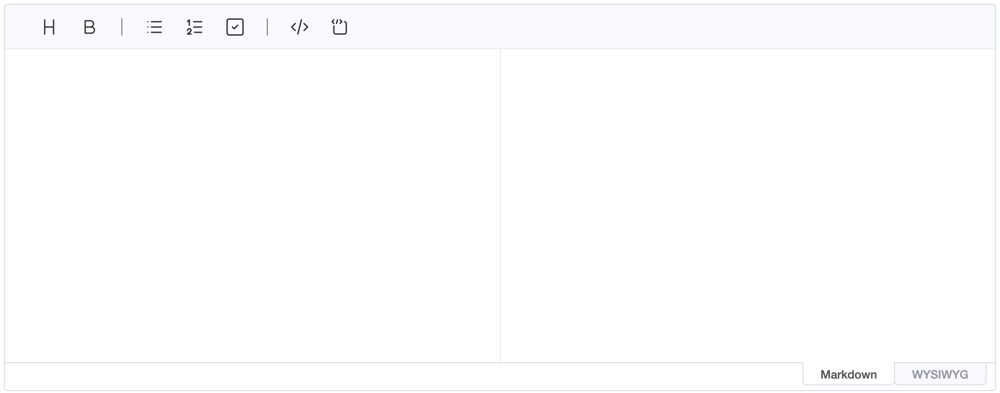
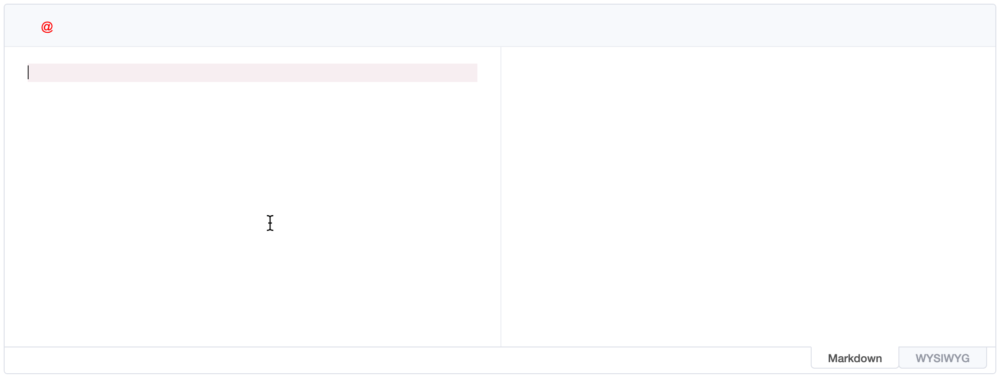
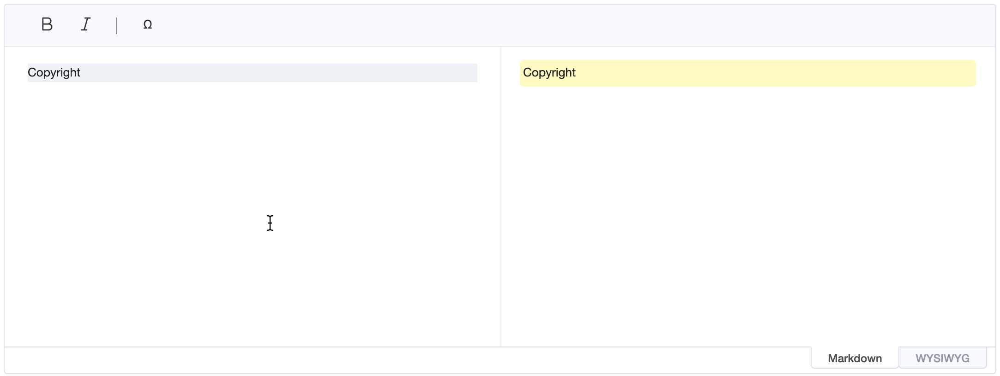
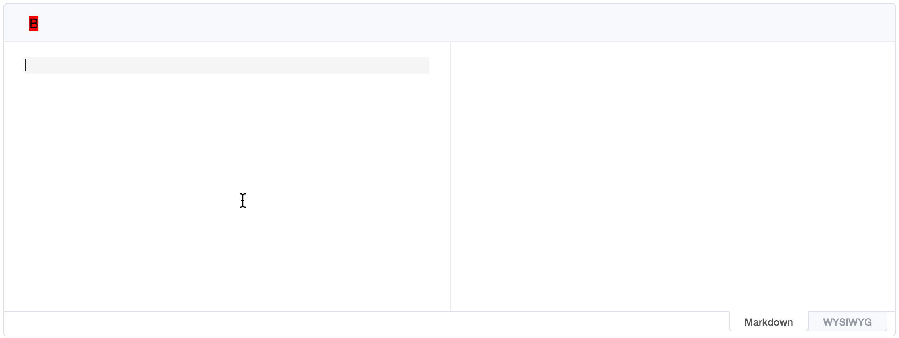
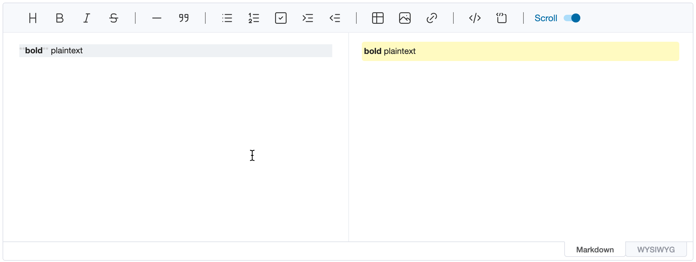

# Toolbar

Typically, the editor can use shortcuts or toolbar to enter specific text or nodes. In particular, in WYSIWYG editors, where no specific textual syntax exists, the role of the toolbar is important because most of the operation are done through the toolbar. UnderFlow also provides a toolbar as the default UI, as well as options and APIs for customization.

## Toolbar Option

The editor provides a total of 17 toolbar items, including bold, italic, and strike. Unless otherwise specified, the default toolbar option is shown below.

```js
const options = {
    // ...
    toolbarItems: [
        ['heading', 'bold', 'italic', 'strike'],
        ['hr', 'quote'],
        ['ul', 'ol', 'task', 'indent', 'outdent'],
        ['table', 'image', 'link'],
        ['code', 'codeblock'],
        ['scrollSync']
    ]
}
```

As you can see in the example code, the toolbar option in the editor is defined in 2D array format. First, each toolbar group is defined as an array, and the toolbar items within the group are designated as items of the array. Each item is rendered in a group in the order in which it is defined, and the toolbar group is rendered separated by the `|` symbol.



If you want to change the configuration of the default toolbar, you can change it by setting the `toolbarItems` option.

```js
const editor = new Editor({
    el: document.querySelector('#editor'),
    toolbarItems: [
        ['heading', 'bold'],
        ['ul', 'ol', 'task'],
        ['code', 'codeblock']
    ]
})
```

The above example code is executed as shown below.



### Adding and Removing Items

`insertToolbarItem()` and `removeToolbarItem()` change the toolbar of an existing editor. An item is the name of a
built-in item or an object like the ones described [below](#toolbar-button-customizing). It's inserted at `itemIndex`
in the group at `groupIndex`; an index past the last group adds a new group at the end.

```js
editor.insertToolbarItem({ groupIndex: 0, itemIndex: 0 }, {
    name: 'myItem',
    tooltip: 'Custom button',
    command: 'bold',
    text: '@',
    className: 'uf-toolbar-icons'
})
editor.insertToolbarItem({ groupIndex: 1, itemIndex: 0 }, 'hr')

editor.removeToolbarItem('myItem')
```

Items are removed by their `name`; built-in items are named as in the `toolbarItems` option.

## Toolbar Button Customizing

The example seen above is actually just a combination of the basic toolbar items. Then what should user do if they  want to create and add a toolbar button? In this case, two main types of options can be customized.

### Button Element Customizing

First, there is a way to customize the toolbar button UI provided by the editor. This method is that overriding only the icon, tooltip, or popup operation of the button embedded in the editor. This option consists of the following interfaces:

| Name        | Type         | Description                                                                                                                                                                                |
| ----------- | ------------ | ------------------------------------------------------------------------------------------------------------------------------------------------------------------------------------------ |
| `name`      | string       | A unique name for the toolbar item and must be specified as required.                                                                                                                      |
| `tooltip`   | string       | Optional value, which defines the tooltip text to show when mouse is over on the toolbar item.                                                                                             |
| `text`      | string       | Optional value, define if the toolbar button element has text to show.                                                                                                                     |
| `className` | string       | Optional value, defines the class to be applied to the toolbar item.                                                                                                                       |
| `icon`      | string       | Optional value, the button's icon as SVG markup. It's drawn 22px wide in the toolbar's icon colour when it uses `currentColor`, like the built-in [Tabler Icons](https://tabler.io/icons). |
| `style`     | Object       | Optional value, defines the style to be applied to the toolbar item.                                                                                                                       |
| `command`   | string       | Optional value, defines the command you want to execute when you click the toolbar button. It has an exclusive relationship with `popup` option.                                           |
| `popup`     | PopupOptions | Optional value, defines if you want to show the popup when you click the toolbar button. This is an exclusive relationship with the `command` option.                                      |

```js
const editor = new Editor({
    el: document.querySelector('#editor'),
    toolbarItems: [
        [{
            name: 'myItem',
            tooltip: 'myItem',
            command: 'bold',
            text: '@',
            className: 'uf-toolbar-icons',
            style: { color: 'red' }
        }]
    ]
    // ...
})
```

The toolbar item is rendered with `className` and `style` options. The item has `@` text node and executes `bold` commands when clicked.

To show an icon instead, pass its SVG markup as `icon`, for example a file your bundler imports as text:

```js
import boldIcon from './my-bold.svg?raw' // Vite; or `with { type: 'text' }` where supported

const editor = new Editor({
    el: document.querySelector('#editor'),
    toolbarItems: [
        [{
            name: 'myBold',
            tooltip: 'Bold',
            command: 'bold',
            icon: boldIcon,
            className: 'uf-toolbar-icons'
        }]
    ]
})
```



### popup Option

When you click the button, you might want to show the popup. In this case, you can use the `popup` option that you saw above. The interface of the `popup` option is shown below.

| Name        | Type        | Description                                                   |
| ----------- | ----------- | ------------------------------------------------------------- |
| `body`      | HTMLElement | Defines the popup DOM node to be rendered.                    |
| `className` | string      | Optional value, defines the class to be applied to the popup. |
| `style`     | Object      | Optional value, defines the style to be applied to the popup. |

The popup is displayed below the button when it's clicked, and disappears when you click elsewhere or emit the
`closePopup` event.

The following code adds a button that shows a popup of symbols; clicking one inserts it at the cursor and closes the
popup.

```js
const symbols = document.createElement('div')

for (const symbol of ['©', '®', '™', '€', '→', '±']) {
    const button = document.createElement('button')

    button.type = 'button'
    button.textContent = symbol
    button.addEventListener('click', () => {
        editor.insertText(symbol)
        editor.eventEmitter.emit('closePopup')
    })
    symbols.appendChild(button)
}

const editor = new Editor({
    el: document.querySelector('#editor'),
    toolbarItems: [
        ['bold', 'italic'],
        [{
            name: 'symbol',
            tooltip: 'Insert symbol',
            text: 'Ω',
            className: 'uf-toolbar-icons',
            popup: { body: symbols, style: { width: 'auto' } }
        }]
    ]
})
```



The up and down arrow keys move the focus between the popup's buttons. In a [plugin](plugin.md), use the
`eventEmitter` from the plugin's `context` instead of `editor.eventEmitter`, and emit the `command` event to run a
command, e.g. `eventEmitter.emit('command', 'bold')`.

## Toolbar Item Customizing

If you want to create a toolbar item without using the default button UI as described above, you need to configure the `el` option as shown below.

```js
const myCustomEl = document.createElement('span')

myCustomEl.textContent = 'B'
myCustomEl.style = 'cursor: pointer; background: red;'
myCustomEl.addEventListener('click', () => {
    editor.exec('bold')
})

const editor = new Editor({
    el: document.querySelector('#editor'),
    toolbarItems: [
        [{
            name: 'myItem',
            tooltip: 'myItem',
            el: myCustomEl
        }]
    ]
    // ...
})
```

The element to be rendered must be specified as an `el` option. In this case, style, event handler, and class must be set, as the option is to create a complete DOM element.

If you run the example code above, it will work as follows.



## Change Toolbar Item State

In the editor, you can activate which node is based on the current cursor's position by changing the style of the toolbar element. For example, if the cursor is located on a `strong` node that displays bold text, an element of the `bold` toolbar item is activated as follows.



If you want to change the state of a customized toolbar element like the example above, you need to configure the `state` option.

```js
const editor = new Editor({
    el: document.querySelector('#editor'),
    toolbarItems: [
        [{
            name: 'myItem',
            tooltip: 'myItem',
            command: 'bold',
            text: '@',
            className: 'uf-toolbar-icons',
            style: { color: 'red' },
            // If it is located on the `strong` node, the `active` CSS class is added to this toolbar element.
            state: 'strong'
        }]
    ]
    // ...
})
```

If the toolbar button is activated according to `state`, the `active` CSS class will be added and you can specify the style that you want using this class.

### `state` list

The state of the toolbar element can only be changed by using the state value below.

-   `heading`: Heading
-   `strong`: Bold
-   `emph`: Italic
-   `strike`: Strike
-   `thematicBreak`: Horizontal Line
-   `blockQuote`: Quotes
-   `bulletList`: Bullet List
-   `orderedList`: Ordered List
-   `taskList`: Task List
-   `table`: Table
-   `code`: Inline Code
-   `codeBlock`: Code Block
-   `indent`, `outdent`: Indent and outdent (disabled outside lists)

### `onUpdated()` option

If a toolbar element is created with the `el` option without using the default button UI, the state can be changed by configuring the `onUpdated` option. Because there is a limit to directly manipulating toolbar elements that are customized, it is going to provide the `onUpdated` callback options.

```js
const myCustomEl = document.createElement('span')

myCustomEl.textContent = 'B'
myCustomEl.style = 'cursor: pointer; background: red;'
myCustomEl.addEventListener('click', () => {
    editor.exec('bold')
})

const editor = new Editor({
    el: document.querySelector('#editor'),
    toolbarItems: [
        [{
            name: 'myItem',
            tooltip: 'myItem',
            el: myCustomEl,
            state: 'strong',
            onUpdated({ active, disabled }) {
                if (active) {
                    myCustomEl.style.background = 'green'
                } else {
                    myCustomEl.style.background = ''
                }
            }
        }]
    ]
    // ...
})
```

The `onUpdated()` function passes the object that represent `active` and `disabled` state as parameter. This parameter allows you to add styling to an element or define the desired operation.
