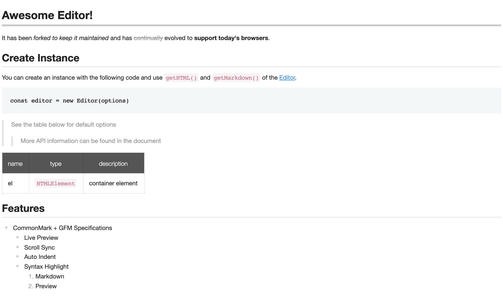

# Viewer

## What Is the Viewer?

UnderFlow provides a **viewer** for showing markdown content without loading the editor. The viewer is much
**lighter** than the editor.

## Creating a Viewer

You create a viewer the same way as an editor (see [Getting Started](getting-started.md)).

### Adding the Container Element

Add the element that the viewer will be created in.

```html
...

<body>
    <div id="viewer"></div>
</body>
...
```

### Importing the Viewer

The viewer is the `Viewer` export of the `@liquid-js/underflow/viewer` entry point.

```js
import { Viewer } from '@liquid-js/underflow/viewer'
```

### Adding CSS Files

Import the contents stylesheet.

```js
import '@liquid-js/underflow/styles/viewer.css'
```

### Creating an Instance

Create an instance with options, then call the viewer's API on it.

```js
const viewer = new Viewer({
    el: document.querySelector('#viewer'),
    initialValue: '# hello'
})
```



The basic option is `initialValue`, the initial markdown content; the viewer is as tall as its content.

All options are documented in the type definitions (`ViewerOptions` in `@liquid-js/underflow`).

## Another Way to Create a Viewer

If your page already loads the editor, `Viewer` is also exported from `@liquid-js/underflow`, or you can create a
viewer with `Editor.factory()` and the `viewer` option.

```js
import { Editor } from '@liquid-js/underflow'

const viewer = Editor.factory({
    el: document.querySelector('#viewer'),
    viewer: true,
    initialValue: '# hello'
})
```
