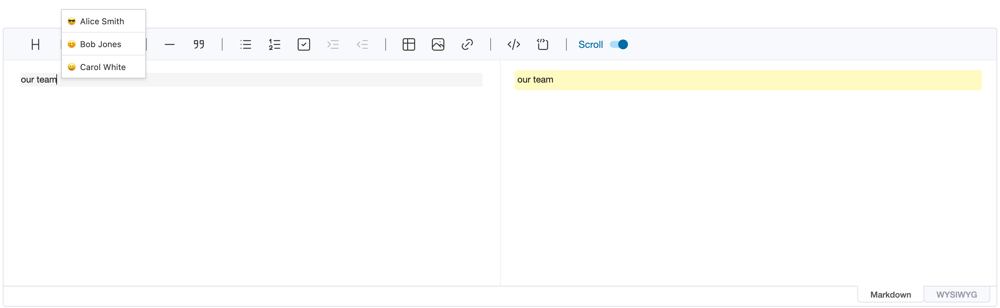
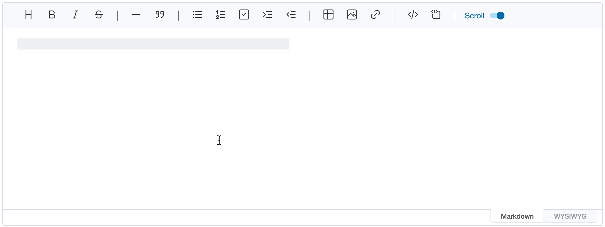
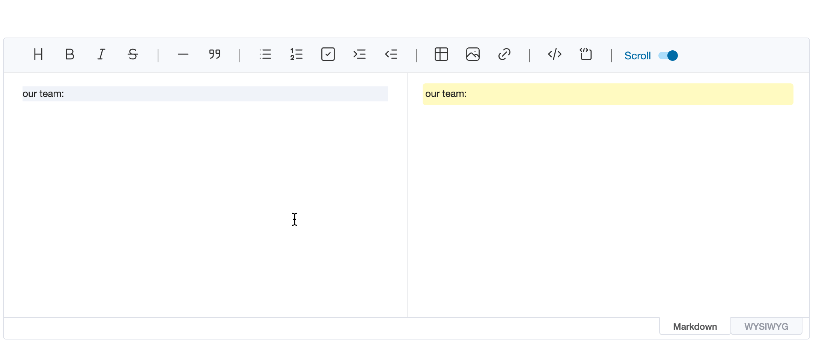

# Widgets

Widgets help with editing content: a popup widget floats a temporary element next to the cursor, such as suggestions
after typing `@`, and an inline widget shows a piece of markdown as a richer element, such as a mention chip for a
profile link.

## Popup Widget

When editing content in the editor, you may want to show the suggestion popup at the current cursor position. At this time, the `addWidget` API can be used to float the DOM node that is desired on the editor. This node does not affect other contents being edited, and is **temporarily added**. In other words, if you enter text or change focus, it disappears. The API signature is as follows.

```ts
addWidget(node: Node, style: WidgetStyle, pos?: EditorPos)
```

| Parameter | Type              | Description                                                                                                         |
| --------- | ----------------- | ------------------------------------------------------------------------------------------------------------------- |
| `node`    | Node              | DOM node to be added as widget                                                                                      |
| `style`   | 'top' \| 'bottom' | Determines whether to add widget above or below the specified position.                                             |
| `pos`     | EditorPos         | Set where the widget will be added. This is optional value, if not set, adds widget to the current cursor position. |

```js
const popup = document.createElement('ul')
// ...

editor.addWidget(popup, 'top')
```

When the above code is executed, a `popup` node is added as shown below.



If you want to show the widget when typing the specific key, `keyup` event is useful.

```js
editor.on('keyup', (editorType, ev) => {
    if (ev.key === '@') {
        const popup = document.createElement('ul')
        // ...

        editor.addWidget(popup, 'top')
    }
})
```

## Inline widgets

Popup widgets are temporary. An inline widget is content: text in the markdown that matches one of the `widgetRules`
is shown as a widget, such as a mention chip for a profile link. The markdown keeps the text itself, so other
renderers (remark, GitHub) show it as ordinary markdown, and `getMarkdown()` returns it unchanged.

```js
// a profile link: [@joe](https://example.com/users/joe)
const reProfile = /\[@(\w+)\]\(https:\/\/example\.com\/users\/\w+\)/

const editor = new Editor({
    el: document.querySelector('#editor'),
    widgetRules: [
        {
            rule: reProfile,
            toDOM(text, { interactive }) {
                const [, name] = text.match(reProfile)
                const chip = document.createElement(interactive ? 'button' : 'span')

                chip.className = 'mention'
                chip.textContent = `@${name}`

                return chip
            },
            toSource(text) {
                const [, name] = text.match(reProfile)

                return [
                    { from: 1, to: 2 + name.length, className: 'mention-name' },
                    { from: 3 + name.length, to: text.length, collapsed: true }
                ]
            }
        }
    ]
})
```

Each rule has:

-   `rule`: the regular expression the widget's markdown text matches. Text in code spans, code blocks and escaped
    text (`\@joe`) doesn't become a widget. When several rules match, the one that matches earliest wins, and the
    first rule among those that match at the same place.
-   `toDOM(text, { interactive })`: the widget's DOM, given the matched text.
-   `toSource(text)` (optional): how the text looks in the markdown editor.

### Where widgets show

| Where                                      | Widgets                                                                                                                               |
| ------------------------------------------ | ------------------------------------------------------------------------------------------------------------------------------------- |
| WYSIWYG editor                             | `toDOM(text, { interactive: true })`: the widget can react to clicks or show controls. It's a single unit that the cursor moves past. |
| Markdown preview, `Viewer` and `getHTML()` | `toDOM(text, { interactive: false })`: the widget as the content will look, without interactive features.                             |
| Markdown editor                            | The text itself, as plain, editable markdown, in an element with the `uf-md-widget` class.                                            |

The `Viewer` takes the same `widgetRules` option. Task checkboxes follow the same split: they can be checked in the
WYSIWYG editor, while the preview and the viewer only show them.



### In the markdown editor

The markdown editor always shows the real markdown, so the user keeps full control of it; widgets only help.
`toSource(text)` returns parts of the matched text, by offsets within it, to style:

-   `className`: class names for the part, e.g. to highlight the user name.
-   `collapsed: true`: hide the part while the cursor is outside the widget, e.g. the URL of a profile link. It shows
    again as soon as the cursor enters the widget.

A click on a widget's text emits `clickWidget` with the text, its position in the markdown (`start`, `end`) and the
mouse event, for example to offer a picker that replaces the text:

```js
editor.on('clickWidget', ({ start, end }) => {
    const picker = createProfilePicker((name) => {
        editor.replaceSelection(`[@${name}](https://example.com/users/${name})`, start, end)
    })

    editor.addWidget(picker, 'bottom', end)
})
```

### Inserting widgets

In the WYSIWYG editor, typed text becomes a widget once it's complete: when the next character doesn't extend the
match, such as a space after a name. Text inserted with `insertText()`, `replaceSelection()` or
`replaceWithWidget()` becomes a widget right away, which suits inserting a mention picked from a popup widget. In the
markdown editor, where positions are `[line, ch]`:

```js
ul.addEventListener('mousedown', (ev) => {
    const name = ev.target.textContent.trim()
    const [start, end] = editor.getSelection()

    // keep the focus in the editor
    ev.preventDefault()

    // replace the typed `@` with the profile link
    editor.replaceSelection(`[@${name}](https://example.com/users/${name})`, [start[0], start[1] - 1], end)
})
```


